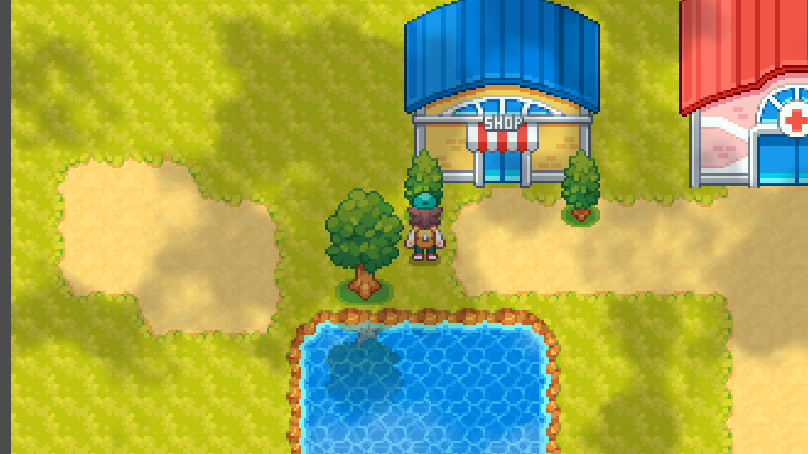
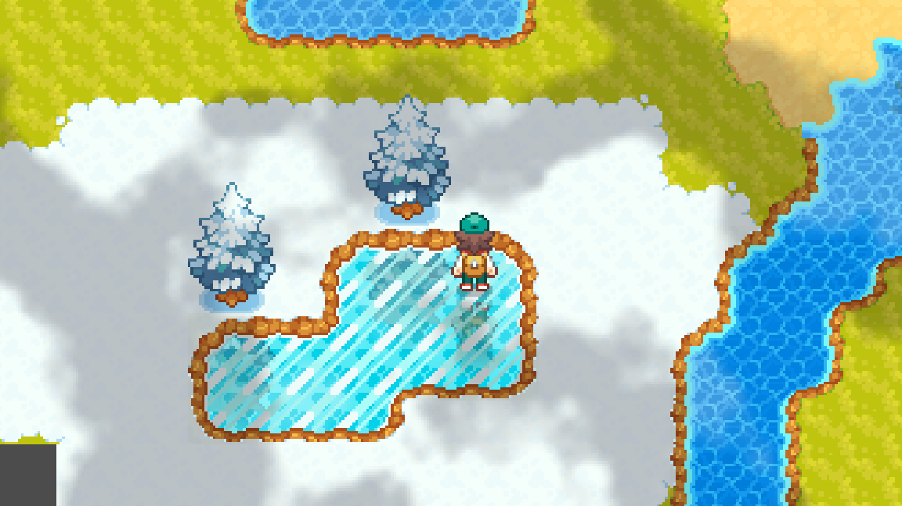
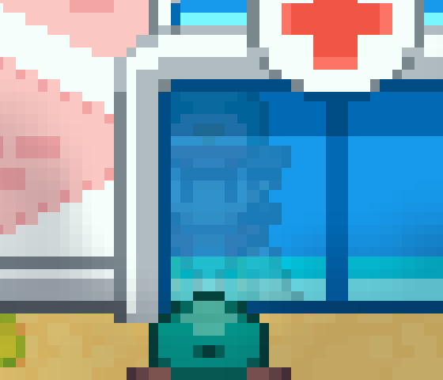

# Top-Down Reflections for Godot 4.5

Pixel-art water and mirror reflections for top-down games made with
`TileMapLayer`. Tag tiles in your TileSet and sprites reflect in them.

| Ice | Mirror |
|---|---|
|  |  |

## Install

Install from the Asset Library, or copy `addons/top_down_reflections/` into
your project. Tested on Godot 4.5.1 with the Compatibility renderer.

## Setup

**1. TileSet.** Add these custom data layers and paint them on your tiles:

- `is_reflective` (bool): water tiles
- `reflection_opacity` (float, optional): per-tile opacity, 0 counts as 1
- `reflection_distortion` (float, optional): 0 = still (ice), 1 = full ripple
- `is_mirror` (bool): glass tiles

**2. Sprites.** Add a `ReflectableComponent` as a child of each sprite that
should reflect, and move it to the sprite's feet. For mirrors, set
`mirror_frame_rules` (Sprite2D sheets) or `mirror_animation_map`
(AnimatedSprite2D) so the reflection shows the other side. Characters need a
physics body to show up in mirrors.

**3. Water.** Add a `ReflectionMaskGenerator` as a child of the water tilemap.
Turn on `debug_mask` and tune `hue_center`, `hue_tolerance`,
`saturation_range` and `value_range` until the water shows red and the shore
yellow. Ripple and cloud settings are on its material; cloud shadows are in
the "Cloud Shadows" group.

**4. Mirrors.** Add a `MirrorMaskGenerator` as a child of the tilemap with the
glass. Set its `z_index` to 1 or more, set `cast_collision_mask` to your
characters' layer, and add the glass colors to `bands` (use `debug_mask` to
check).

**5. Draw order.** Use y-sort with object origins at their feet. For
buildings, set the tiles' Y Sort Origin to the building's bottom edge instead
of raising their `z_index`.

## Demo

Clone this repository and press F5 to run `demo/demo.tscn`. Move with the
arrow keys.

## Limits

- A character standing in front of glass covers most of their own reflection.
- Only tested with the Compatibility renderer.

## License

Code: MIT, see `LICENSE`. The demo art is not covered by it.

Demo art: [MPWSP01](https://scarloxy.itch.io/mpwsp01) by Scarloxy, used under
the author's terms.
